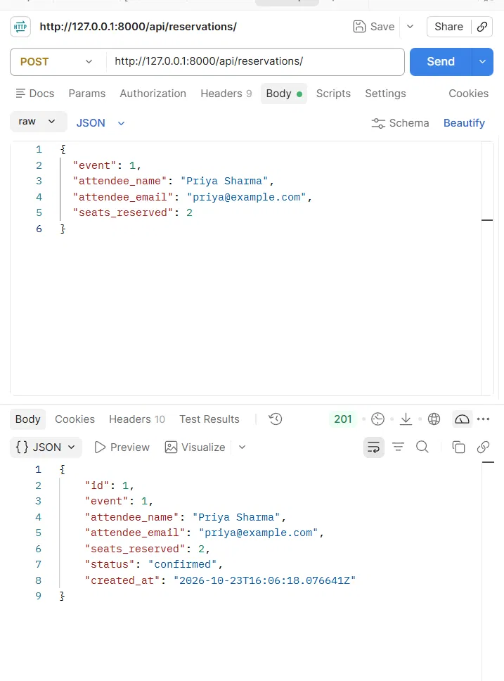
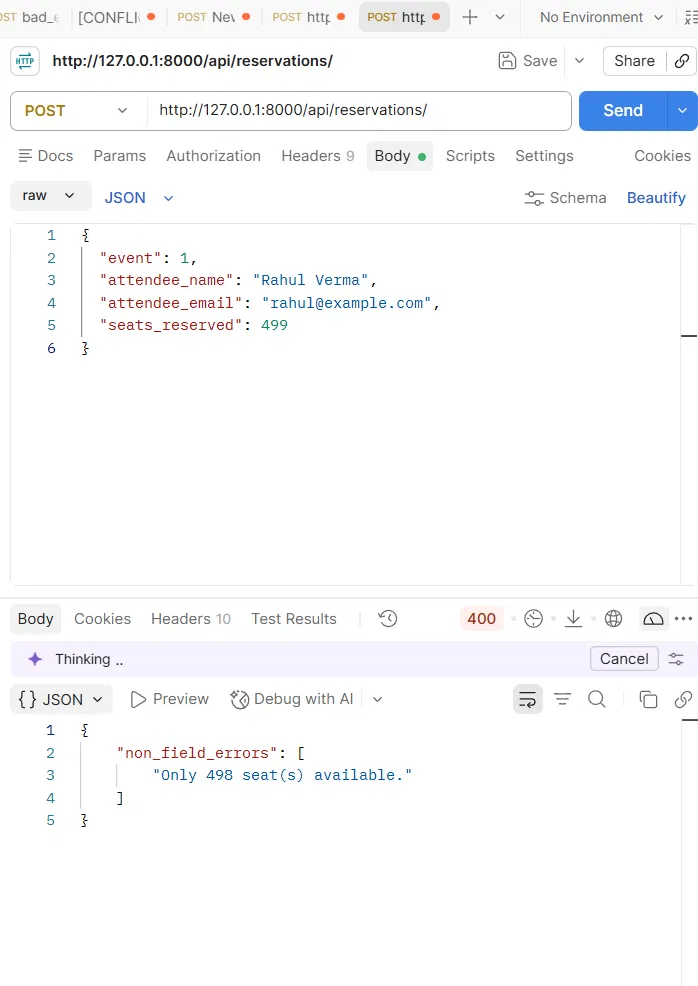
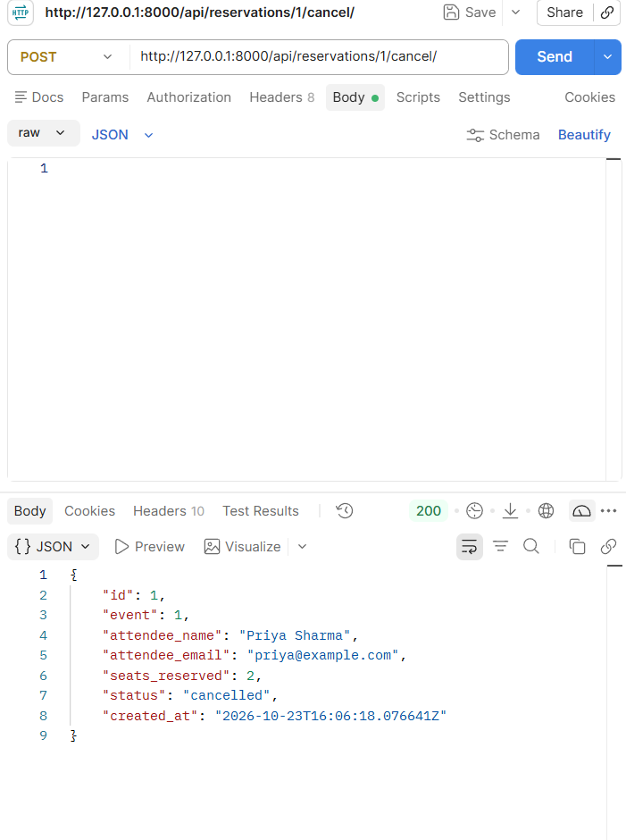
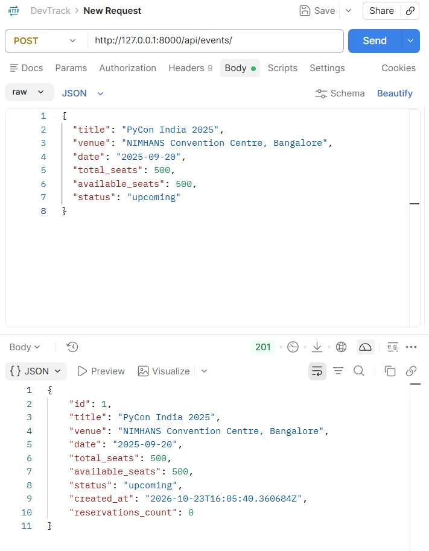
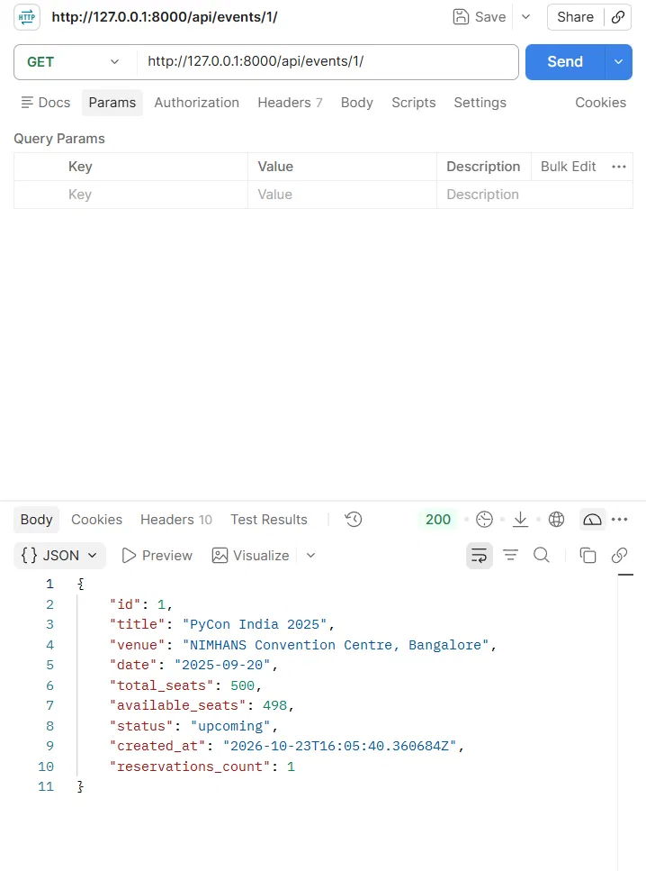
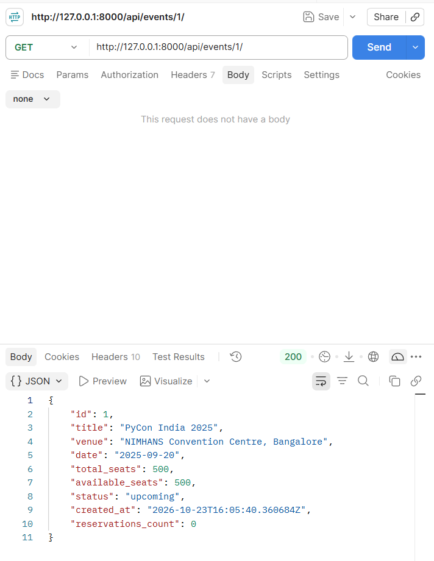
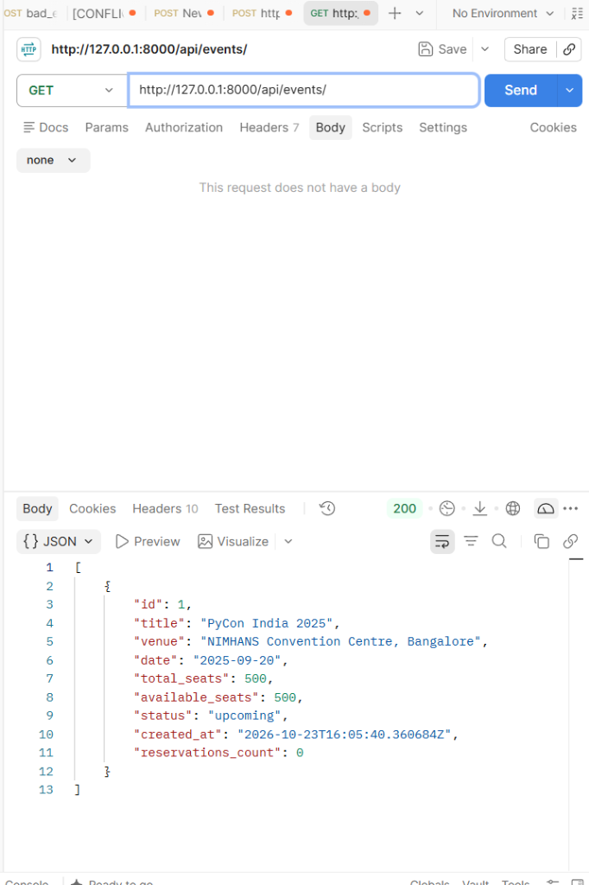

# EventHub

EventHub is a simple REST API for event ticketing. You can create events, reserve seats for an event, and cancel a reservation. The API checks seat availability, so an event cannot be overbooked.

## Tech stack

- Python 3.12+
- Django 6.1
- Django REST Framework 3.18
- SQLite (the `db.sqlite3` file in the project folder)

## How to run the project

1. Clone the repository and go into the project folder:

   ```bash
   git clone https://github.com/Krishanu-das-05/eventhub-assignment-airtribe.git
   cd eventhub-assignment-airtribe
   ```

2. Create and activate a virtual environment.

   Windows (PowerShell):

   ```powershell
   python -m venv .venv
   .venv\Scripts\Activate.ps1
   ```

   macOS / Linux:

   ```bash
   python3 -m venv .venv
   source .venv/bin/activate
   ```

3. Install the packages:

   ```bash
   pip install -r requirements.txt
   ```

4. Apply the database migrations:

   ```bash
   python manage.py migrate
   ```

5. Start the development server:

   ```bash
   python manage.py runserver
   ```

The base URL of the API is: **http://127.0.0.1:8000/api/**

To run the automated tests:

```bash
python manage.py test
```

You can open this URL in a browser to use the Django REST Framework browsable API, or use a tool like Postman.

The secret key is read from the `DJANGO_SECRET_KEY` environment variable. You do not need to set it for local development: if it is missing, a random key is made each time the server starts.

## Endpoints

| Method | URL | What it does |
|--------|-----|--------------|
| GET | `/api/events/` | List all events (ordered by date) |
| POST | `/api/events/` | Create a new event |
| GET | `/api/events/{id}/` | Get one event |
| PUT | `/api/events/{id}/` | Update an event (all fields) |
| PATCH | `/api/events/{id}/` | Update some fields of an event |
| DELETE | `/api/events/{id}/` | Delete an event (its reservations are deleted too) |
| GET | `/api/reservations/` | List all reservations (newest first) |
| POST | `/api/reservations/` | Reserve seats for an event |
| GET | `/api/reservations/{id}/` | Get one reservation |
| PUT | `/api/reservations/{id}/` | Update a reservation (all fields) |
| PATCH | `/api/reservations/{id}/` | Update some fields of a reservation |
| DELETE | `/api/reservations/{id}/` | Delete a reservation (its seats go back to the event if it was confirmed) |
| POST | `/api/reservations/{id}/cancel/` | Cancel a reservation and give the seats back to the event |

Notes on updating a reservation with PUT or PATCH:

- If you change `seats_reserved`, the event's `available_seats` changes by the difference. Asking for more seats than are left gives `400 Bad Request`.
- A reservation cannot be moved to another event.
- You cannot change the seats of a cancelled reservation.

### Filters

| URL | What it does |
|-----|--------------|
| `/api/events/?status=upcoming` | Events with this status (`upcoming`, `ongoing`, `completed` or `cancelled`) |
| `/api/events/?venue=bangalore` | Events whose venue contains this text (not case-sensitive) |
| `/api/reservations/?event_id=1` | Reservations for the event with this id |

You can use both event filters together, for example `/api/events/?status=upcoming&venue=bangalore`.

## Sample requests and responses

The ids in these examples may be different on your machine.

### 1. Create an event

`POST /api/events/`

```json
{
  "title": "PyCon India 2025",
  "venue": "NIMHANS Convention Centre, Bangalore",
  "date": "2025-09-20",
  "total_seats": 500,
  "available_seats": 500,
  "status": "upcoming"
}
```

Response: `201 Created`

```json
{
  "id": 1,
  "title": "PyCon India 2025",
  "venue": "NIMHANS Convention Centre, Bangalore",
  "date": "2025-09-20",
  "total_seats": 500,
  "available_seats": 500,
  "status": "upcoming",
  "created_at": "2026-10-23T16:05:40.360684Z",
  "reservations_count": 0
}
```

### 2. Reserve seats

`POST /api/reservations/`

```json
{
  "event": 1,
  "attendee_name": "Priya Sharma",
  "attendee_email": "priya@example.com",
  "seats_reserved": 2
}
```

Response: `201 Created`

```json
{
  "id": 1,
  "event": 1,
  "attendee_name": "Priya Sharma",
  "attendee_email": "priya@example.com",
  "seats_reserved": 2,
  "status": "confirmed",
  "created_at": "2026-10-23T16:06:18.076641Z"
}
```

The event now has `"available_seats": 498`.

### 3. Overbooking attempt

`POST /api/reservations/`

```json
{
  "event": 1,
  "attendee_name": "Rahul Verma",
  "attendee_email": "rahul@example.com",
  "seats_reserved": 499
}
```

Response: `400 Bad Request`

```json
{
  "non_field_errors": ["Only 498 seat(s) available."]
}
```

### 4. Cancel a reservation

`POST /api/reservations/1/cancel/` (no request body needed)

Response: `200 OK`

```json
{
  "id": 1,
  "event": 1,
  "attendee_name": "Priya Sharma",
  "attendee_email": "priya@example.com",
  "seats_reserved": 2,
  "status": "cancelled",
  "created_at": "2026-10-23T16:06:18.076641Z"
}
```

The 2 seats go back to the event, so it has `"available_seats": 500` again. If you cancel the same reservation again, you get `400 Bad Request` with `{"error": "Already cancelled."}`.

## Middleware

The project has a custom middleware called `RequestLoggingMiddleware` (in `events/middleware.py`). For every request, it logs one line with:

- the HTTP method
- the path
- the response status code
- how long the request took, in seconds

Example:

```
POST /api/reservations/ - 201 - 0.03s
```

The log goes through the `events.middleware` logger, which is set up in `LOGGING` in `eventhub/settings.py`. You will see these lines in the terminal where `python manage.py runserver` is running, next to Django's own request log. The query string (for example `?status=upcoming`) is not part of the logged path.

## Design decision

I deduct the seats and create the reservation inside the same `create()` method of the serializer, so both writes happen together in one place. This keeps the code simple and easy to follow. But it is not safe when many people book at the same time, because two requests could both pass the availability check before either one saves. Then the event could end up with more bookings than seats. In production I would wrap `create()` in `transaction.atomic()` and lock the event row with `select_for_update()`, so only one booking can change the seat count at a time.

## Screenshots

1. Reservation created (201): 
2. Overbooking attempt (400): 
3. Reservation cancelled (200): 
4. Event created (201): 
5. Event after the reservation, 498 seats left (200): 
6. Event after the cancellation, 500 seats again (200): 
7. List of events (200): 
